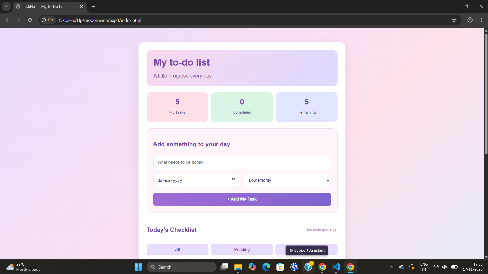
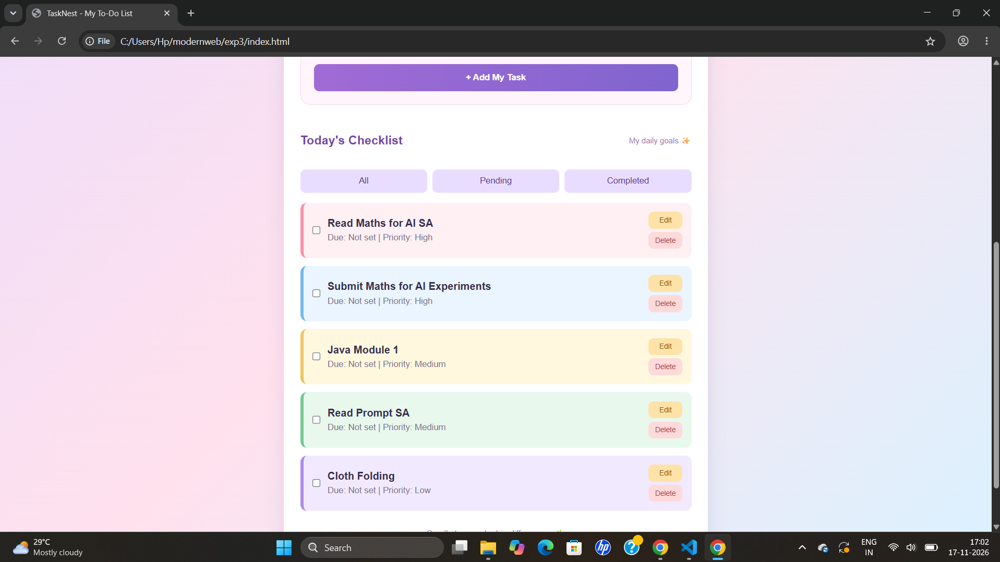

# Ex03 To-Do List using JavaScript
## Date:17-11-2026

## AIM
To create a To-do Application with all features using JavaScript.

## ALGORITHM
### STEP 1
Build the HTML structure (index.html).

### STEP 2
Style the App (style.css).

### STEP 3
Plan the features the To-Do App should have.

### STEP 4
Create a To-do application using Javascript.

### STEP 5
Add functionalities.

### STEP 6
Test the App.

### STEP 7
Open the HTML file in a browser to check layout and functionality.

### STEP 8
Fix styling issues and refine content placement.

### STEP 9
Deploy the website.

### STEP 10
Upload to GitHub Pages for free hosting.

## PROGRAM
```
index.html

<!DOCTYPE html>
<html>
<head>
    <title>TaskNest - My To-Do List</title>
    <link rel="stylesheet" href="style.css">
</head>
<body>

<div class="container">

    <header>
        <div>
            <h1>My to-do list</h1>
            <p>A little progress every day.</p>
        </div>
       
    </header>

    <div class="dashboard">
        <div>
            <h2 id="total">5</h2>
            <p>My Tasks</p>
        </div>
        <div>
            <h2 id="completed">0</h2>
            <p>Completed</p>
        </div>
        <div>
            <h2 id="pending">5</h2>
            <p>Remaining</p>
        </div>
    </div>

    <section class="add-section">
        <h3>Add something to your day</h3>

        <input type="text" id="taskInput"
               placeholder="What needs to be done?">

        <div class="form-row">
            <input type="date" id="taskDate">

            <select id="priority">
                <option value="Low">Low Priority</option>
                <option value="Medium">Medium Priority</option>
                <option value="High">High Priority</option>
            </select>
        </div>

        <button class="add-btn" onclick="addTask()">
            + Add My Task
        </button>
    </section>

    <section class="list-section">
        <div class="list-heading">
            <h3>Today's Checklist</h3>
            <span>My daily goals ✨</span>
        </div>

        <div class="filters">
            <button onclick="setFilter('all')">All</button>
            <button onclick="setFilter('pending')">Pending</button>
            <button onclick="setFilter('completed')">Completed</button>
        </div>

        <div id="taskList"></div>
    </section>

    <p class="footer">
        Small steps make big differences 🌿
    </p>

</div>

<script src="script.js"></script>
</body>
</html>

style.ccs

* {
    box-sizing: border-box;
}

body {
    margin: 0;
    padding: 25px;
    font-family: Arial, sans-serif;
    background: linear-gradient(135deg, #e9ddff, #ffe1ed, #d9f2ff);
    color: #39304f;
}

.container {
    max-width: 650px;
    margin: 20px auto;
    background: white;
    padding: 25px;
    border-radius: 20px;
    box-shadow: 0 8px 25px rgba(80,50,120,0.12);
}

/* Header */

header {
    display: flex;
    justify-content: space-between;
    align-items: center;
    background: linear-gradient(120deg, #f8d8ef, #ded9ff);
    padding: 22px;
    border-radius: 15px;
}

header h1 {
    color: #7546a5;
    margin: 0;
    font-size: 30px;
}

header p {
    color: #765e8b;
    margin-bottom: 0;
}

.sun {
    font-size: 32px;
}

/* Dashboard */

.dashboard {
    display: flex;
    justify-content: space-around;
    gap: 10px;
    margin: 20px 0;
    text-align: center;
}

.dashboard div {
    flex: 1;
    padding: 12px 5px;
    border-radius: 12px;
}

.dashboard div:nth-child(1) {
    background: #ffe0e8;
}

.dashboard div:nth-child(2) {
    background: #d9f5e4;
}

.dashboard div:nth-child(3) {
    background: #e1e5ff;
}

.dashboard h2 {
    margin: 5px;
    color: #7049a3;
}

.dashboard p {
    font-size: 12px;
    color: #655b75;
}

/* Add Task */

.add-section {
    background: #fff5fb;
    padding: 20px;
    border-radius: 15px;
    border: 1px solid #f4d9ed;
}

h3 {
    color: #7546a5;
}

input, select {
    width: 100%;
    padding: 12px;
    border: 1px solid #e3d5ef;
    border-radius: 8px;
    margin: 7px 0;
    background: white;
    color: #39304f;
}

.form-row {
    display: flex;
    gap: 10px;
}

.form-row > * {
    flex: 1;
    min-width: 0;
}

button {
    border: none;
    border-radius: 8px;
    padding: 10px 14px;
    cursor: pointer;
    background: #e9ddff;
    color: #633c91;
    transition: 0.2s;
}

button:hover {
    opacity: 0.8;
    transform: translateY(-2px);
}

.add-btn {
    width: 100%;
    background: linear-gradient(100deg, #a16bd5, #8064cf);
    color: white;
    margin-top: 10px;
    padding: 13px;
    font-weight: bold;
}

/* Task List */

.list-section {
    margin-top: 25px;
}

.list-heading {
    display: flex;
    justify-content: space-between;
    align-items: center;
    gap: 8px;
}

.list-heading span {
    font-size: 12px;
    color: #9a76b6;
}

.filters {
    display: flex;
    gap: 8px;
    margin: 15px 0;
}

.filters button {
    flex: 1;
    background: #e9ddff;
}

.filters button.active {
    background: #8064cf;
    color: white;
}

/* Task Cards */

.task-card {
    display: flex;
    align-items: center;
    gap: 10px;
    background: #f5f0ff;
    border-left: 5px solid #a17bd5;
    padding: 14px;
    margin: 12px 0;
    border-radius: 10px;
}

.task-card:nth-child(5n+1) {
    background: #fff0f3;
    border-left-color: #ff8eaa;
}

.task-card:nth-child(5n+2) {
    background: #eaf5ff;
    border-left-color: #75b9ed;
}

.task-card:nth-child(5n+3) {
    background: #fff8df;
    border-left-color: #edc65c;
}

.task-card:nth-child(5n+4) {
    background: #e8f8ed;
    border-left-color: #73c993;
}

.task-card:nth-child(5n+5) {
    background: #f1eaff;
    border-left-color: #ad8be9;
}

.task-card.done {
    opacity: 0.7;
}

.task-card input {
    width: auto;
    margin: 0;
}

.task-details {
    flex: 1;
    min-width: 0;
}

.task-details strong {
    display: block;
    overflow-wrap: anywhere;
}

.task-details small {
    display: block;
    color: #81768e;
    margin-top: 5px;
}

.done strong {
    text-decoration: line-through;
}

/* Action Buttons */

.actions {
    display: flex;
    flex-direction: column;
    gap: 5px;
}

.actions button {
    font-size: 11px;
    padding: 7px 10px;
}

.edit {
    background: #ffe2a8;
    color: #865719;
}

.delete {
    background: #ffdada;
    color: #a33d50;
}

/* Footer */

.footer {
    text-align: center;
    color: #987bb0;
    font-size: 13px;
    margin-top: 25px;
}

/* Mobile View */

@media(max-width: 500px) {
    body {
        padding: 10px;
    }

    .container {
        padding: 15px;
    }

    .form-row {
        flex-direction: column;
        gap: 0;
    }

    .task-card {
        gap: 7px;
    }
}

script.js

let tasks = [
    { id: 1, text: "Read Maths for AI SA", date: "", priority: "High", completed: false },
    { id: 2, text: "Submit Maths for AI Experiments", date: "", priority: "High", completed: false },
    { id: 3, text: "Java Module 1", date: "", priority: "Medium", completed: false },
    { id: 4, text: "Read Prompt SA", date: "", priority: "Medium", completed: false },
    { id: 5, text: "Cloth Folding", date: "", priority: "Low", completed: false }
];

let filter = "all";

if (localStorage.getItem("taskNest")) {
    tasks = JSON.parse(localStorage.getItem("taskNest"));
}

function saveTasks() {
    localStorage.setItem("taskNest", JSON.stringify(tasks));
}

function addTask() {
    let text = document.getElementById("taskInput").value.trim();
    let date = document.getElementById("taskDate").value;
    let priority = document.getElementById("priority").value;

    if (text === "") {
        alert("Please enter a task!");
        return;
    }

    tasks.push({
        id: Date.now(),
        text: text,
        date: date,
        priority: priority,
        completed: false
    });

    document.getElementById("taskInput").value = "";
    document.getElementById("taskDate").value = "";

    saveTasks();
    displayTasks();
}

function displayTasks() {
    let list = document.getElementById("taskList");
    list.innerHTML = "";

    let filtered = tasks.filter(task => {
        if (filter === "pending") return !task.completed;
        if (filter === "completed") return task.completed;
        return true;
    });

    if (filtered.length === 0) {
        list.textContent = "No tasks found!";
    }

    filtered.forEach(task => {
        let card = document.createElement("div");
        card.className = "task-card";

        if (task.completed) {
            card.classList.add("done");
        }

        let checkbox = document.createElement("input");
        checkbox.type = "checkbox";
        checkbox.checked = task.completed;

        checkbox.onchange = function() {
            task.completed = checkbox.checked;
            saveTasks();
            displayTasks();
        };

        let details = document.createElement("div");
        details.className = "task-details";

        let title = document.createElement("strong");
        title.textContent = task.text;

        let info = document.createElement("small");
        info.textContent =
            "Due: " + (task.date || "Not set") +
            " | Priority: " + task.priority;

        details.append(title, info);

        let actions = document.createElement("div");
        actions.className = "actions";

        let edit = document.createElement("button");
        edit.textContent = "Edit";
        edit.className = "edit";

        edit.onclick = function() {
            let newText = prompt("Edit your task:", task.text);

            if (newText !== null && newText.trim() !== "") {
                task.text = newText.trim();
                saveTasks();
                displayTasks();
            }
        };

        let del = document.createElement("button");
        del.textContent = "Delete";
        del.className = "delete";

        del.onclick = function() {
            tasks = tasks.filter(t => t.id !== task.id);
            saveTasks();
            displayTasks();
        };

        actions.append(edit, del);
        card.append(checkbox, details, actions);
        list.appendChild(card);
    });

    updateDashboard();
}

function updateDashboard() {
    let total = tasks.length;
    let completed = tasks.filter(t => t.completed).length;
    let pending = total - completed;

    document.getElementById("total").textContent = total;
    document.getElementById("completed").textContent = completed;
    document.getElementById("pending").textContent = pending;
}

function setFilter(value) {
    filter = value;

    document.querySelectorAll(".filters button").forEach(button => {
        button.classList.remove("active");
    });

    event.target.classList.add("active");

    displayTasks();
}

displayTasks();

```


## OUTPUT



## RESULT
The program for creating To-do list using JavaScript is executed successfully.
